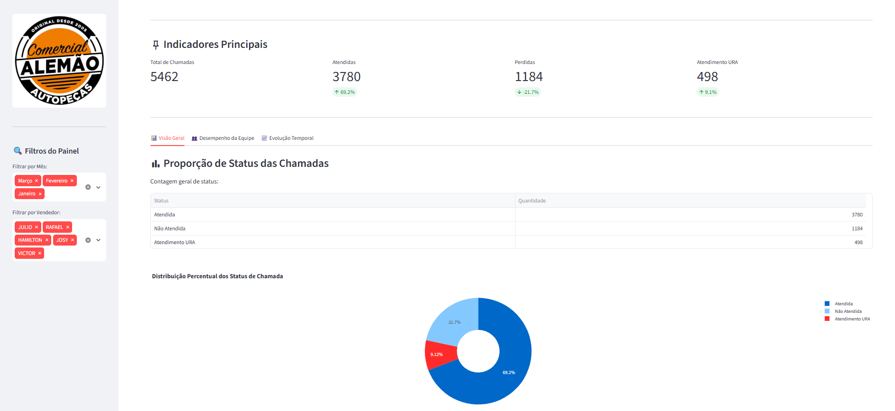

# Painel de Análise de Chamadas

Aplicação web em Python e Streamlit que transforma relatórios de chamadas do sistema de telefonia em um dashboard interativo, com indicadores de atendimento, desempenho por vendedor e evolução mensal das chamadas perdidas.

Desenvolvido para a equipe gerencial da Alemão Autopeças, substituindo a análise manual das planilhas exportadas do sistema.



## O problema

Os relatórios de chamadas saem do sistema de telefonia como planilhas separadas, uma por período, e analisá-las manualmente é lento e sujeito a erro. A gestão precisava responder rapidamente perguntas como:

- Quantas chamadas foram atendidas e quantas foram perdidas?
- Como cada vendedor está se saindo?
- A taxa de chamadas perdidas está melhorando ou piorando ao longo dos meses?

## Funcionalidades

- **Upload de múltiplos relatórios** (`.xls` ou `.xlsx`), consolidados automaticamente em uma única base.
- **Filtros** por mês e por vendedor, mantendo as chamadas de URA (que não têm agente associado).
- **Indicadores principais:** total de chamadas, atendidas, perdidas e atendimento por URA, com percentuais.
- **Visão geral:** distribuição dos status das chamadas em gráfico de rosca.
- **Desempenho da equipe:** chamadas atendidas por vendedor e tabela cruzada de status por agente, com gráfico de barras empilhadas.
- **Evolução temporal:** volume de chamadas por mês e taxa de perda mensal (%).

## Tecnologias

| Uso | Ferramenta |
| --- | --- |
| Linguagem | Python |
| Interface web | Streamlit |
| Tratamento de dados | pandas, lxml |
| Gráficos | Plotly |

## Como executar

1. Clone o repositório:

   ```bash
   git clone https://github.com/laujuliani/painel-chamadas-alemao.git
   cd painel-chamadas-alemao
   ```

2. Instale as dependências:

   ```bash
   pip install -r requirements.txt
   ```

3. Inicie o painel:

   ```bash
   streamlit run app.py
   ```

4. No navegador, envie um ou mais relatórios de chamadas pelo botão de upload.

## Formato esperado dos relatórios

Os relatórios são exportados do sistema de telefonia (Sonax) como arquivos `.xls` que, na prática, contêm uma tabela HTML; por isso a leitura é feita com `pandas.read_html`. O painel espera, no mínimo, as colunas:

| Coluna | Descrição |
| --- | --- |
| `Data/hora` | Data e hora da chamada |
| `Agente` | Vendedor que atendeu (vazio nas chamadas de URA) |
| `Status` | `Atendida`, `Não Atendida` ou `Atendimento URA` |

> Nenhum dado real de chamadas está incluído neste repositório.

## Estrutura do projeto

```
painel-chamadas-alemao/
├── app.py              # Aplicação Streamlit (leitura, filtros, KPIs e gráficos)
├── requirements.txt    # Dependências
└── README.md
```

## Próximos passos

- [ ] **Resumo automático com IA:** gerar, a partir das métricas calculadas, um texto em linguagem natural destacando os principais pontos do período (por exemplo, variações na taxa de perda e vendedores com maior volume de chamadas não atendidas), utilizando a API de um LLM.
- [ ] Análise por dia da semana e por faixa de horário, para identificar picos de chamadas perdidas.
- [ ] Exportação do resumo e dos indicadores em PDF.

